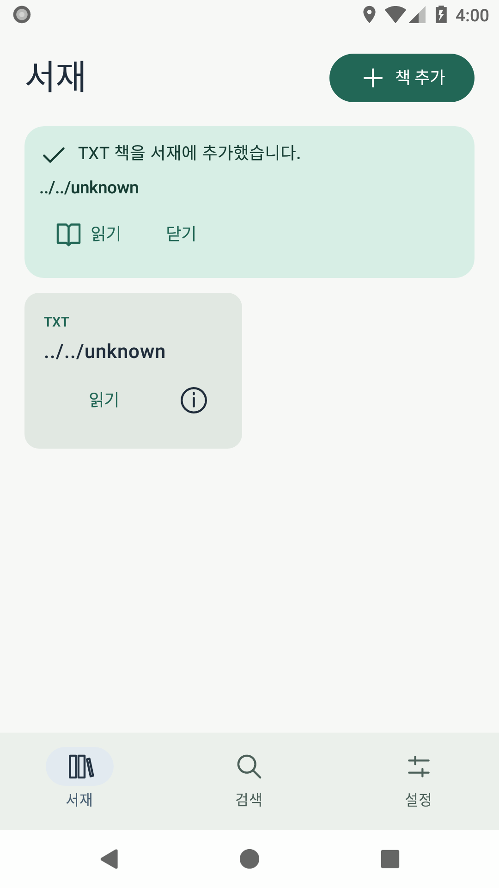
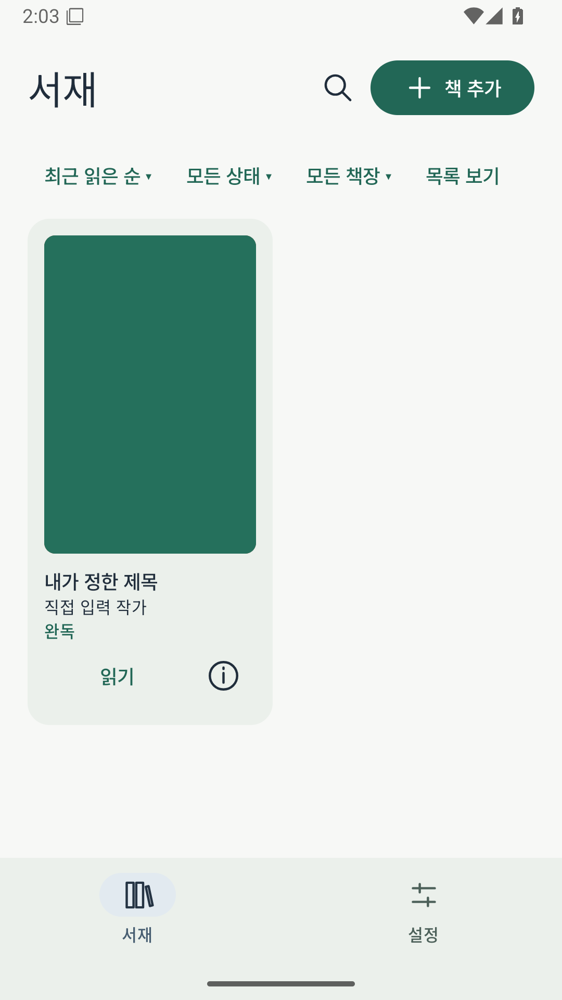

# 서재 2.0 / 0.6.0

2026-10-29. 사용자 계획의 Phase 2를 구현하고 자동 검증했다.
소스 `a22970b1e40eaf06c47acaa683b9d754eb66f2b4`, 개발 브랜치 `codex/library-060`. main과 기존0.5.1 설치 파일은 보존했다.
실제 휴대전화 설치·성능·TalkBack·공개 배포는 완료 범위에 포함하지 않는다.

## 사용자 경험과 기능

서재에서 표지·제목·작가·읽기 상태·진행률로 책을 찾고 관리한다.
격자/목록, 최근 읽기/추가 날짜/제목/작가 정렬, 상태·책장 필터를 저장한다.
검색은 서재 상단에서 열며 화면 밖 EPUB의 메타데이터도 순차 추출하여 검색한다.
하단은 서재·설정과 Reader 밖 이어읽기이며, 새 프로세스의 시작 화면은 계속 서재다.

책 정보에서 제목·작가·표지·읽기 상태·책장을 편집한다. EPUB의 실제 메타데이터/표지,
Comic의 첫 유효 이미지, TXT 및 추출 실패 시6가지 생성 표지를 사용한다.
사용자 이미지의 작은 복사본을 보관하고 수동 편집은 늦은 자동 추출보다 우선한다.
완독 표시는 실제 독서 위치를 변경하지 않는다. 큰 시스템 글자 크기는 카드 본문에 적용하고
장식 표지 내부는 작은 폭에 맞춰 표시한다.

책장을 만들고 이름을 바꾸거나 삭제할 수 있다. 길게 눌러 여러 책을 선택해 분류하며,
책장 삭제는 분류만 해제한다. 파일 선택기에서 최대64개 책을 순차 가져오고 완료·중복·실패를 구분한다.
취소·일부 실패·강제 종료 시 완료된 책을 유지하며 대기 중인 인코딩 작업은 복구한다.
임시 URI 권한이 사라진 남은 파일은 다시 선택하도록 안내한다.

## 주요 소스

- `shared/.../library/LibraryCatalog.kt`, `RoomLibraryManager.kt`, `database/LibraryDao.kt`, `Migrations.kt`: 서재 모델·편집 우선권·분류·명시적migration.
- `androidApp/.../library/BookCoverStore.kt`, `AndroidLibraryArtwork.kt`, `epubAndroid/.../library/BoundedCoverImage.kt`: 표지 추출·저장·디코드 한도와 취소.
- `androidApp/.../ui/LibraryComponents.kt`, `BookReaderApp.kt`, `AppViewModel.kt`, `MainActivity.kt`: 서재/편집/책장/검색/일괄 처리와 반복 표지 선택.
- `epub/EpubReaderController.kt`: 교체된 host의 후속 검색 위치 callback도 보존한다.
- `LibraryCatalogTest`, `MigrationTest`, `LibraryArtworkAndroidTest`, `LibraryBatchHostProcessTest`, `ManagedImportAndroidTest`, `BookReaderScreenTest`, `scripts/library-batch-process-check.py`: 실제 저장·UI·강제 종료 검증.

## 실제 화면 변화

이전에는 파일명 중심 카드와 단순 정보 창이었으며 검색이 별도 탭이었다.
현재는 표지와 읽기 상태, 상단 검색·정렬·필터, 저장 가능한 정보 편집과 책장이 있다.
아래 화면은 생성 fixture를 실제 Android 에뮬레이터에서 실행한 원본 캡처다.
API26의 `phase2-library.png`는 Activity 재생성 뒤에도 이전 편집 창 프레임을 담았다.
편집 창 semantics 소멸·저장/재생성 데이터 검사는 PASS지만 이 이미지는 저장 후 서재의 시각 증거로 사용하지 않는다.
API34/36에서 서재를 확인했으며 API26 원본도 그대로 보존한다. 책장 캡처에는 필터 메뉴가 열린 모습이 있다.

| 0.5.1 / API26 | 0.6.0 / API36 |
|---|---|
|  |  |

[정보 편집](evidence/product-quality/verified-a22970b/40885971811/mobile-device-evidence-api-26/build/device-evidence/fixture-screenshots/phase2-book-editor.png) ·
[책장/목록](evidence/product-quality/verified-a22970b/40885971811/mobile-device-evidence-api-26/build/device-evidence/fixture-screenshots/phase2-shelf-list.png) ·
[일괄 처리 결과](evidence/product-quality/verified-a22970b/40885971811/mobile-device-evidence-api-26/build/device-evidence/fixture-screenshots/phase2-batch-results.png) ·
[큰 글자/다크 모드](evidence/product-quality/verified-a22970b/40885971811/mobile-device-evidence-api-36/build/device-evidence/fixture-screenshots/phase1-library-large-dark.png).

## 검증

[build 40885971844](https://github.com/LaceyLuv/BookreaderM/actions/runs/40885971844),
[device 40885971811](https://github.com/LaceyLuv/BookreaderM/actions/runs/40885971811),
[검증 요약과 원본](evidence/product-quality/verified-a22970b/summary.json).
서버 artifact SHA-256/ZIP CRC, 실행 source SHA와 clean 상태, 필수 XML 사례,
외부 force-stop 후 PID 부재·교체와 EPUB 실제 p179 표시를 대조했다.

| 검사 | 결과 |
|---|---|
| 원격 build | PASS175: Android unit73/shared JVM83/EPUB unit16/실제 ENOSPC3, APK/test APK/lint/schema6 |
| API26/34/36 | 각각 native72 + host7 PASS, 실패·오류·skip0 |
| 기존 Reader 강제 종료 | TXT/EPUB/Comic 각각 준비·새 프로세스 복원2단계 PASS/API |
| 일괄 가져오기 강제 종료 | 진행 중 durable checkpoint 뒤 외부 force-stop, cold Library/기록·책장·인코딩 job 복구1단계 PASS/API. 의도적으로 종료한 준비는 JUnit PASS로 세지 않음 |
| 서재·표지 측정 | 1,000권 격자/목록 끝·처음·검색 탐색 및24개 표지 교체 PASS. bitmap 보유7,962,624bytes ≤8MiB, 퇴출된 표시 중 bitmap 보존. 에뮬레이터 검사이며 물리 FPS가 아님 |
| 패키지 | 같은 인증서/v2/v3,4 ABI·16KB ZIP/ELF 정적 정렬, 서명 전후612 ZIP entry 바이트 동일, ZIP CRC·추출 APK SHA 동일 PASS |
| 실기기·TalkBack·16KB OS·실제 사용자 서재 | NOT_RUN/BLOCKED_ENV: 연결 기기 없음 |
| 공개 릴리스·대화 다운로드·배포 자동화 | 미완료 |

정확한 명령/exit code는 각 원본 `results.txt`와 로컬 로그를 따른다.
최종 검사: `python3 /workspace/work/bookreaderm-product-quality/verify.py a22970b1e40eaf06c47acaa683b9d754eb66f2b4 40885971844 40885971811` exit0.
[중간 개발 기록](LIBRARY_0_6_DEVELOPMENT.md)의 실패는 보존했으며 timeout/정확한 위치 assertion을 완화하지 않았다.
표지 재선택은 같은 이미지 키가 빠르게 반환되어도 성공 선택 번호로 화면에 전달한다.

## 데이터 호환성과 자원

[ADR0008](adr/0008-library-catalog-and-covers.md). Room5→6은 별도 서재 테이블만 추가한다.
기존 Book의 원본·revision·epoch 필드, 진행도·북마크·설정·사용자 글꼴을 초기화하지 않는다.
이전1–5 스키마 업그레이드·실패 롤백·늦은 추출/편집 경합·분류 롤백과 원본 SHA 보존을 검사했다.
사용자 책·개인 URI·서명키를 CI에 업로드하지 않았으며 모든 실행 fixture는 생성/재배포 허용 자료다.

자동 표지128MiB, 영구 사용자 표지128MiB, 표시 bitmap8MiB 한도를 적용한다.
EPUB/사용자 표지 입력8MiB, JPEG 결과384×576px/768KiB 이하이다.
Comic은 기존 엔트리64MiB/bitmap8MiB budget과 첫8개 후보만 사용한다.
추출은 직렬화하고 Reader 진입 시 취소하며, 강제 종료 뒤 남은 파생 spool은 다음 유지보수에서 정리한다.
관리 원본과 선택한 표지를 orphan spool처럼 삭제하지 않는다.

같은 키의 시험용 APK/ZIP 정보는 [설치 기록](INSTALLABLE_APK.md), [패키지 증거](evidence/product-quality/package-a22970b/summary.json)를 따른다.
기존0.5.1 APK 해시와 서명키 stat도 동일함을 확인했다. 실제 설치본의 무손실 업데이트는 실기기 검사가 남아 있다.

## 남은 문제와 다음 단계

중간 abee6a1 API36에서 Compose 측정 재진입이 한 번 발생했다. 후속 전체 실행에서는 재발하지 않았으나
원인 해결로 단정하지 않는다. 실제 휴대전화 성능·접근성·전체 파일 호환성·공개 전달 경로도 남아 있다.
main 통합과 공개 릴리스를 수행하지 않았다.

Phase3은 별도 `/workspace/BookreaderM-reader-070`, `codex/reader-070`에서 착수했다.
bounded TXT 목차 분석기의 새6개와 기존83개 JVM 검사가 PASS다. DB/UI 연결과 기능 완료는 아직 아니다.
이후 목차 수정/제외·회차 이동, 도구/빠른 설정과 revision에 묶인 형광펜/메모를 진행한다.
정확한 UTF-16 선택 범위와 기존 페이지/스크롤 layout·제스처 보존을 먼저 검증하고,
EPUB는 고정 Readium의 공개 selection/decoration API와 완전 Locator를 사용한다.
Phase3/4 기능을 이 단계에서 완료했다고 보고하지 않는다.
