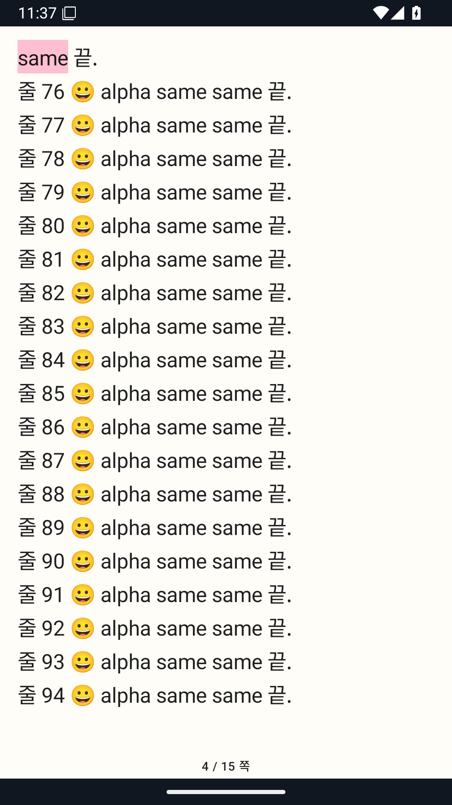
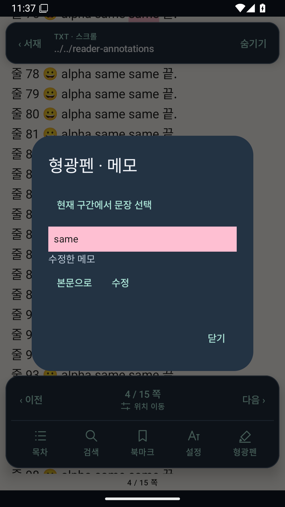
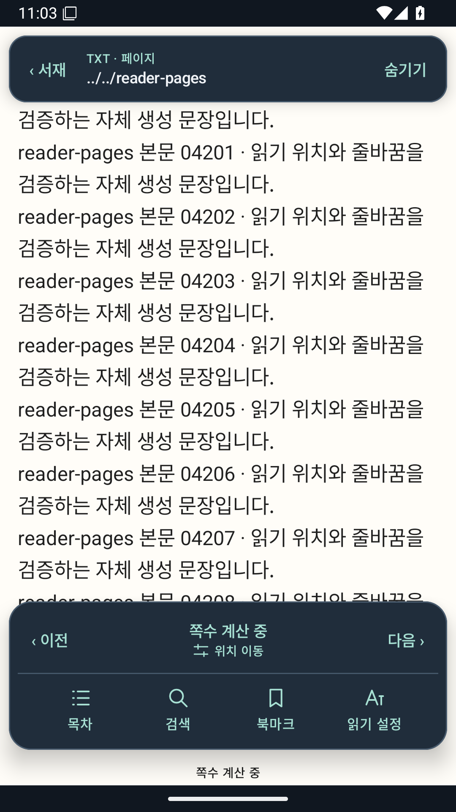
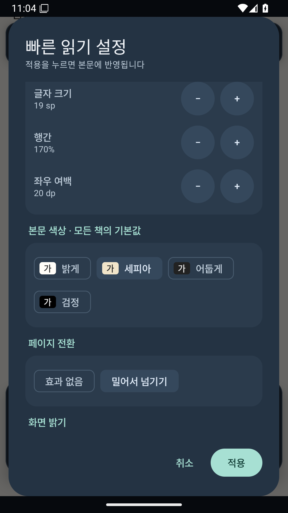
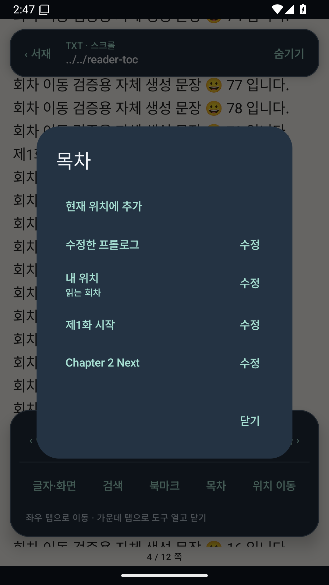

# 독서 경험 강화 / 0.7.0 개발 기록

## 2026-11-07 EPUB 형광펜·메모 — 구현 및 기기 검증 중

현재 소스 `65a57bcff8388bdbacfe2ef7b3467cac887027ea`, 0.7.0-dev/code10/Room9.
본문을 길게 누른 선택 메뉴에서4색 형광펜과 메모를 저장하고 목록에서 수정·삭제·본문 이동을 제공한다.
Readium 공개 API와 정확한 DOM UTF-16 범위·문맥 대조를 함께 사용한다.
[설계와 한도](adr/0011-exact-epub-annotations.md), [실행 상태·다음 작업](SESSION_HANDOFF.md).
기존13개 테이블 정의를 유지하고 epub_annotations만 추가했다. 관리 원본·진행도·기존 키·이전 APK/main은 보존한다.
[보존 대조](evidence/product-quality/phase3-epub-menu-local/preservation.json).

이모지 포함 XHTML이 Android Xalan에서 invalid surrogate entity로 변환되던 기존 문제를 수정했다.
별도 API26 Dalvik의 실제 앱 변환 검사와 독립 XML roundtrip17개 PASS. 소프트웨어 AVD UI 검사는
System UI 응답 없음 때문에 BLOCKED_ENV이며 성공으로 사용하지 않는다.
[원본·첫 실패·수정 후 결과](evidence/product-quality/phase3-epub-unicode-local/summary.json).
3e10382 원격 build42366128291 PASS210(Android77/shared113/EPUB17/실제 ENOSPC3).
API34/36은 새 거부 검사 PASS, 실제 선택 이후 메뉴 클릭1 FAIL. 기존75개 검사는 PASS다.
[실패 원본](evidence/product-quality/failed-3e10382/summary.json). API26은 실행 중이다.

65a57bc는 선택 전에 접근성 조회를 연결하고 native floating 창의 실제 메뉴를 누르도록 검사를 보완했다.
로컬 `source /workspace/toolchains/mobile-env.sh; ./gradlew :androidApp:compileDebugAndroidTestKotlin :androidApp:lintDebug --console=plain` exit0.
[컴파일·lint 원본](evidence/product-quality/phase3-epub-menu-local/summary.json).
build42367624823/device42367624851 진행 중이며 전체 기기 PASS는 아직 아니다.
이전 a259e0b/ec788cd/a46551a 실패 원본과 SDK 빈 문맥 생략 호환 수정도 보존한다.
다음은 실제 메뉴·SDK 사각형·리플로·재열기·host force-stop 검증과 실패 수정이다.
실기기/TalkBack/성능/공개 배포는 NOT_RUN, Phase4는 미착수다.

## 2026-11-06 최신 — TXT 형광펜·메모 자동 검증 완료

`/workspace/BookreaderM-reader-070`, `codex/reader-070`, 제품/테스트 소스 `208f74caf788bf9a72d1640d4e30926ae0a29716`.
0.7.0-dev/code9/Room8. [결정·범위](adr/0010-exact-txt-annotations.md).
TXT의 **형광펜 → 현재 구간에서 문장 선택**에서 실제 선택 좌표로 저장한다. 네 가지 색상, 선택적 메모,
목록에서 수정/삭제/정확한 본문 이동을 제공한다. 같은 문장을 검색해 위치를 추정하지 않는다.
현재 위치부터 최대4,096 UTF-16 단위의 읽기 전용 선택 창이며, 본문의 기본 복사 선택은 유지한다.
최대500개/내용 버전, 메모2,000 UTF-16 단위다. EPUB 형광펜은 다음 단위이며 Phase3 전체 완료는 아니다.

기존12개 테이블 정의를 그대로 두고 txt_annotations만 추가했다. 실제1–7→8 migration/rollback과
raw 책·진행도·북마크·설정·목차 보존, stale session/CAS/미래 값/한도/SQL 오류를 검사했다.
표시·저장 전에 원문의 정확한 구간을 대조하며, 불일치한 기록을 다른 문장에 붙이지 않는다.
SQLite TEXT 길이와 BLOB 바이트 길이를 함께 검사해 NUL 뒤의 과대 기록도 읽기 전에 거부한다.
기존 진행도/locator/캐시/페이지/Readium 계약28개 파일과 서명키/이전 설치 APK/main을 보존했다.

build42210038416 PASS200(Android77/shared104/EPUB16/실제 ENOSPC3),
device42210038417 API26/34/36 각각 native75+host7 PASS. 실패·오류·skip0.
[필수 XML·원본·대조](evidence/product-quality/verified-208f74c/summary.json): artifact SHA/CRC/source clean,
외부 force-stop 뒤 PID 부재·교체, EPUB p179 실제 가시성까지 확인했다.
`python3 /workspace/work/bookreaderm-product-quality/verify-phase3.py 208f74caf788bf9a72d1640d4e30926ae0a29716 42210038416 42210038417` exit0.
실제 길게 누르기와 두 번째 반복 문장 선택, TextLayoutResult의 정확한 형광펜 범위,
메모 수정·리플로·페이지 전환·재열기·삭제·외부 강제 종료 복원을 검사했다.

로컬 전체197 및 APK/test APK/lint/schema8 PASS. 마지막 화면 보완의 compile/lint/릴리스 APK·AAB exit0.
[로컬 원본](evidence/product-quality/phase3-annotations-bound-local/summary.json),
[최초 잘못된 surrogate fixture 실패와 수정](evidence/product-quality/phase3-annotations-local/summary.json),
[초기 전체 기기 결과](evidence/product-quality/verified-ae4453d/summary.json),
[바이트 한도 보완본 전체 결과](evidence/product-quality/verified-242ae6b/summary.json)를 보존한다.
초기 긴 설정 라벨/가장자리 캡처는 [원본 시각 검토](evidence/product-quality/annotations-visual-ae4453d/review.json)에 남겼다.
세 API의 실제 본문·메모 목록·도구 화면을 확인했다. 선택한 단어 전체의 분홍 표시와 짧아진 설정 라벨이 잘리지 않는다.
[원본 시각 검토·한계](evidence/product-quality/verified-208f74c/visual-review.json). 도구 캡처의 쪽수 계산 중 표시는 최종 쪽수 정확성 증거로 사용하지 않는다.
이전 Phase2 측정 재진입과19a8235 API26 도구 캡처의 원인 미확정 기록도 유지한다.

실기기 설치·TalkBack·성능·공개 배포는 NOT_RUN. 이번에는 새 설치 파일을 전달하지 않았다.
다음 단위는 Readium 공개 선택 locator/Decoration에 기반한 EPUB 형광펜·메모다. Phase4 백업·복원은 미착수다.
매 shell `source /workspace/toolchains/mobile-env.sh`. 실행 상태/helper는 `phase3-annotations/current.json`, `ci/`다.

## 2026-11-06: 도구 모음·빠른 읽기 설정 자동 검증 완료

TXT·EPUB·Comic 도구에 직접 만든 벡터 아이콘과 짧은 이름을 적용했다. 하단 쪽수 영역의 위치 이동 버튼은
기존 미리보기/취소 슬라이더를 연다. 상·하단 여백과 설명을 줄이고 overlay/본문 viewport는 유지한다.
기존 `ReaderSettingsDialog`의 한 draft와 저장 callback을 재사용한다. 글자 크기·행간·기본 글꼴·굵기·여백·색상·
읽기 방식·전환·밝기는 바로 표시하고, 파일 글꼴 관리·자간·화면 고정/전체화면·전체 기본 읽기 방식은 추가 설정으로 분리했다.
책별 읽기 방식과 전체 기본값의 범위를 명시한다. 상속 복원은 `readingMode`만 비워 다른 책별 값을 보존한다.
EPUB에서 행간/자간을 직접 바꾸면 기존 글꼴/굵기 선택과 같이 출판사 스타일을 해제해 변경값을 반영한다.

주요 파일: `ReaderToolButton.kt`, `ReaderChrome.kt`, `ReaderSettingsDialog.kt`, `CustomFontSettings.kt`,
세 포맷 `*ReaderScreen.kt`, `res/drawable/ic_reader_*.xml`.
DB·설정 codec·저장소·locator·진행도 writer·Readium host·TXT 본문 측정/캐시는 수정하지 않았다. 0.7.0-dev/code8/Room7 유지.

새 실제 UI 검사는 설정 취소의 raw row/viewport/진행도 불변, 빠른 항목 적용 후 정확한 canonical anchor,
상속 복원 시 만화 방향/맞춤 보존, Activity 재생성 및 서재 재열기 후 설정/진행도를 확인한다.
기존 큰 글자 1.0/1.3/2.0·사용자 글꼴·EPUB p179/host 교체·TOC·Comic 회귀는 유지하고 추가 설정을 여는 단계만 맞췄다.
로컬 CI exit0, Android75/shared95/EPUB16=186 및 APK/test APK/lint/schema7 PASS.
[원본](evidence/product-quality/phase3-controls-local/summary.json). 제품/테스트 소스 `19a82358746063d97826f04d992c16a30026319b`.
[build41194371543](https://github.com/LaceyLuv/BookreaderM/actions/runs/41194371543) PASS189(ENOSPC3 포함),
[device41194371545](https://github.com/LaceyLuv/BookreaderM/actions/runs/41194371545) API26/34/36 각 native74+host7 PASS.
[원본636개·대조](evidence/product-quality/verified-19a8235/summary.json). digest/CRC/필수 XML/source clean/실제 PID 교체,
EPUB p179의 실제 가시성 검증 exit0. 릴리스 APK/AAB 컴파일 exit0. 강제 종료와 Activity 재생성을 구분해 검사했다.
원본 로그는 `/workspace/work/bookreaderm-product-quality/phase3-controls/`.

기존 키와 이전에 전달한05ffd50 APK를 보존했다. 형광펜/메모·Phase4와 실기기 성능/접근성·공개 배포는 남아 있다.
다음은 정확한 TXT·EPUB 선택 범위를 바탕으로 한 형광펜/메모다. 기존 위치 북마크와 별도로 설계하며 원문과 진행도를 보존한다.

전후 비교: 이전에는 5개 텍스트 도구와 별도 위치 이동 버튼을 나열했다. 이제 주요 4개 도구는 아이콘/이름으로,
위치 이동은 쪽수와 묶었다. 설정은 같은 editor draft에서 자주 쓰는 값과 펼쳐 쓰는 추가 설정을 구분한다.
책별 읽기 방식과 전체 글자/화면 기본값의 범위를 화면에 표시한다. 아래는 실제 API36 원본이다.

[이전 도구 화면](evidence/product-quality/verified-05ffd50/40892825193/mobile-device-evidence-api-36/build/device-evidence/fixture-screenshots/txt-controls.png).
API26/34/36 빠른 설정, API34/36 새 도구, API26/36 TXT·EPUB 일반 도구, API36 Comic 도구 원본을 확인했다.
API26 `phase3-reader-tools.png`에는 닫기 직후 검색/북마크 라벨 배치 이상이 있어 안정 화면 증거로 사용하지 않는다.
같은 실행의 `txt-controls.png`와 `epub-controls.png`는 정상이나 캡처/렌더링 원인은 미확정이다.
[시각 검토](evidence/product-quality/verified-19a8235/visual-review.json). 실기기 설치·TalkBack·성능은 NOT_RUN이다.
Phase2의 API36 측정 재진입은 이번에 재발하지 않았지만 원인 해결로 기록하지 않는다.
DB7 및 기존 설정 codec/저장소, locator/진행도/cache/본문 측정/Readium host 등84개 파일은 이전 검증 소스와 동일하다.
기존 서명키의 크기·수정 시각과05ffd50 APK의 해시를 재확인했다. 새 설치 파일이나 공개 릴리스를 전달/게시하지 않았다.

## 2026-10-29 현재: TXT 목차 단위 자동 검증 완료

`0.7.0-dev`/code8, Room7. [ADR0009](adr/0009-txt-toc-overrides.md).
목차 버튼에서 자동 후보와 현재 회차를 보고 이동하며, 제목 수정·제외/복구·현재 위치 수동 추가를 구현했다.
새 Reader 코루틴은 스캔·읽기·편집을 소유하고, 닫기/재시도/Reader 종료에서 취소한다.
수정 기록은 contentRevision별 별도 테이블과 sessionEpoch/기존 row 재검사로 보호한다.
기존 source/진행도/북마크/설정/서재 기록을 덮어쓰지 않는다. UI를 열거나 편집하는 동작으로 위치를 저장하지 않는다.

주요 소스: `TxtToc.kt`, `RoomTxtTocRepository.kt`, `TxtTocDao.kt`, `Migrations.kt`,
`TxtReaderToc.kt`, `ReaderTocDialog.kt`, `TxtReaderController.kt`, `TxtReaderScreen.kt`, `AndroidStores.kt`.
실제 UI 검사는 새 `TxtReaderFlowTest`에서 편집/제외/복구/수동 추가/정확한 이동/재열기/원본 해시를 확인한다.
기존 TXT host flow에 목차의 실제 외부 force-stop 후 복원과 원본 진행도 불변 검사를 추가했다.
새 실제 UI 캡처는 아래 API36 원본이다. API26/34에는 닫히는 추가 창의 프레임이 남아
최종 목록의 시각 증거로 사용하지 않는다. 그 원본도 삭제/편집하지 않았다.
[자체 생성 fixture 출처·해시](../fixtures/txt-toc-manifest.json).

로컬 shared95/Android unit75, APK 테스트 소스 컴파일/lint PASS. 정확한 명령은
`./gradlew :androidApp:compileDebugAndroidTestKotlin :androidApp:testDebugUnitTest :androidApp:lintDebug :shared:jvmTest --console=plain` exit0.
[원본](evidence/product-quality/phase3-toc-local/). 최초 migration95개 중1 FAIL은 fixture가 서재 설정 키를
`global` 대신 `library`로 넣은 오류였다. 실제 계약에 맞춰 수정했고 실패 XML도 보존했다.
필수 사례의 JVM 이름은 검사기가 정규화하는 `[jvm]` 없는 이름으로 등록했다.
전체 로컬 CI exit0, Android75/shared95/EPUB16=186개와 APK/test APK/lint/schema7 PASS.
제품/테스트 source `05ffd50ab8213ec9563a92149b6ed1930c510c3b`.
[build40892825363](https://github.com/LaceyLuv/BookreaderM/actions/runs/40892825363) PASS189(실제 ENOSPC3 포함),
[device40892825193](https://github.com/LaceyLuv/BookreaderM/actions/runs/40892825193) API26/34/36 각각 native73+host7 PASS.
[원본 요약](evidence/product-quality/verified-05ffd50/summary.json)의 artifact SHA/CRC, 필수 XML, source clean,
실제 force-stop/PID 부재·교체를 대조했다. 기존 EPUB p179와 TXT/Comic 위치 회귀도 유지했다.
`python3 /workspace/work/bookreaderm-product-quality/verify-phase3.py 05ffd50ab8213ec9563a92149b6ed1930c510c3b 40892825363 40892825193` exit0.
`./gradlew :androidApp:assembleRelease :androidApp:bundleRelease --console=plain` exit0. 설치 배포는 하지 않았다.

이전 TXT 도구는 검색·북마크·위치 이동이었으며, 이제 회차 목록에서 현재 항목을 보고 직접 편집/이동한다.

Room6→7은 목차 수정 테이블만 추가하며 기존11개 테이블 정의는 동일하다.
[기존 locator/progress/cache/page/font/Readium 소스 불변](evidence/product-quality/phase3-toc-local/preserved-contracts.json).
기존1–6 스키마 migration/롤백, 미래 값·오래된 세션·동시 수정·삭제된 책·한도/DB 오류를 검사했다.
원본·독서 기록·북마크·설정·서재 분류를 수정하지 않는다. 사용자 책/URI/키를 CI에 올리지 않았다.

남은 한계: 자동 감지는 보수적인 후보이며 모든 소설의 제목 형식을 인식하지 않는다.
자동 후보5,000/수정1,000/제목120 UTF-16 단위 한도가 있다. 실기기 성능·TalkBack·전체 사용자 파일은 NOT_RUN이다.
중간 Phase2의 API36 Compose 측정 재진입 원인은 여전히 미확정이며 이번 전체 실행에서는 재발하지 않았다.
다음은 기존 overlay와 저장 경로를 재사용한 도구/빠른 설정, 정확한 선택 구간을 저장하는 형광펜/메모다.

형광펜/메모, 독서 도구 재설계·빠른 설정과 Phase4는 미완료다. 검증된0.6.0 APK/브랜치는 별도로 보존한다.

아래는 첫 단위의 이력이다.

2026-10-29, `codex/reader-070`, 작업 위치 `/workspace/BookreaderM-reader-070`.
Phase2 제품 fe29dea의 build175/세 API native72+host7을 확인한 뒤 별도 worktree에서 착수했다.
0.6.0 최종 캡처/문서 작업은 `/workspace/BookreaderM`의 `codex/library-060`에서 보존한다.

## 첫 단위: TXT 자동 목차 분석기

`shared/.../toc/TxtTocScanner.kt`는 canonical UTF-16 범위를16,384단위씩 읽으며
256단위를 넘는 행을 버리고 제목120단위/후보5,000개로 제한한다. 취소를 검사하고
reader가 surrogate 경계 때문에 짧게 돌려준 실제 길이만큼만 전진한다.
제N화·N화·제N장·N회·Chapter N·프롤로그·에필로그와 대괄호 제목을 감지한다.
일반 숫자/본문 중 언급/접미사가 붙은 문장/지나치게 긴 행은 후보로 올리지 않는다.
보수적 자동 후보이므로 수동 추가·수정·제외 UI와 revision별 저장을 다음 단위에서 연결한다.

JVM6개가 한글/영문/emoji/창 경계/CRLF/중복 제목의 서로 다른 정확한 offset,
1백만 글자 긴 줄·후보 제한·취소·잘못된 reader 응답을 검사한다.
첫 `./gradlew :shared:jvmTest --console=plain` exit0, shared89개 PASS.
로그 `/workspace/work/bookreaderm-product-quality/phase3-toc-scanner.log`.
현재 UI와 DB는 연결 전이며 사용자가 쓸 수 있는 목차 기능 완료로 보고하지 않는다.
스키마/버전/기존 Reader와 서명키를 아직 변경하지 않았다.

## 다음 단위

1. book/revision/version에 묶인 수정·제외·수동 목차 저장과 migration/롤백 검증.
2. Reader 소유 비동기 스캔/취소, 목차 목록·현재 회차·정확한 위치 이동.
3. 도구/빠른 설정과 정확한 선택 범위를 사용하는 TXT·EPUB 형광펜/메모.

고정 Compose1.9.3/Readium3.1.2 공개 API를 확인했다. SelectionContainer의 좌표 callback은 internal이므로 사용하지 않는다.
BasicTextField의 공개 TextFieldValue selection과 기존 측정/제스처 계약을 실제 Android에서 비교해야 한다.
EPUB는 공개 currentSelection/applyDecorations와 완전 SDK Locator를 사용한다.
원본 source jar SHA/API 메모는 작업 폴더 `phase3-api/`, `phase3-notes.md`에 보존했다.
