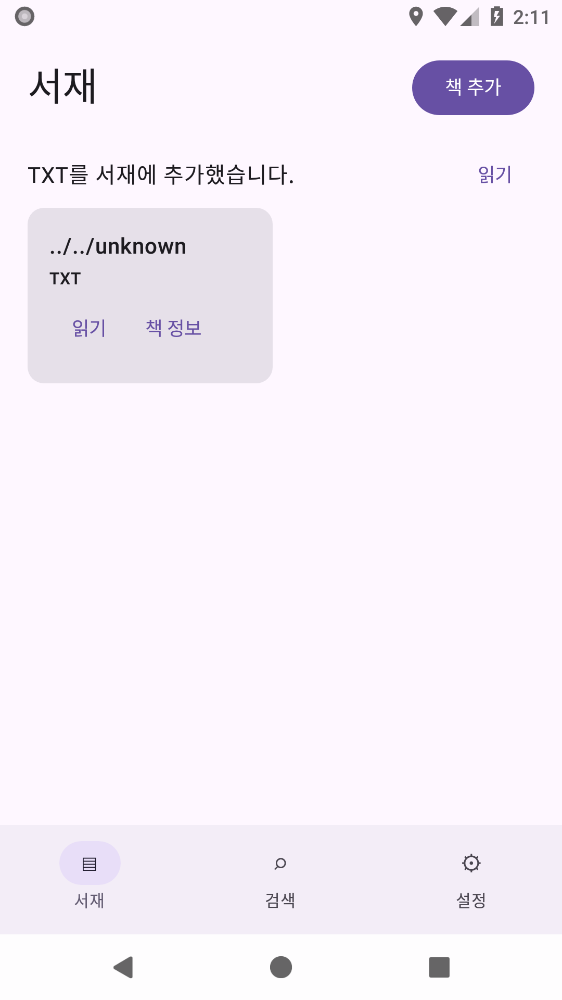

# 0.5.1 — 기존 UX 정리

사용자의 [제품 개선 지침](reference/BookReaderM_Product_Improvement_Request_2026-10-24.md)에 따라
[전체 감사](PRODUCT_IMPROVEMENT.md) 후 Phase 1을 구현했다. 제품/테스트 소스는
`5a8aad2ebb35359740a2fe18bec0c3731d6e9072`, 브랜치는 `codex/product-quality-051`이다.
main790175b와 기존 0.5.0은 보존한다. Phase 1 구현·자동 검증을 완료했다. 실기기 검증은 별도 미실행이다.

## 사용자가 확인할 변화

| 이전 | 0.5.1 |
|---|---|
| EPUB·만화도 TXT 추가 안내 | 실제 책 형식에 맞는 완료/공유 안내 |
| 사용할 수 없는 책을 눌러도 반응 없음 | 파일 없음·손상·미지원·삭제 중을 구분하고 다음 행동 안내 |
| 빈 화면과 빈 검색 결과에 다음 행동 없음 | 책 추가, 검색 초기화, 오류 재시도 |
| 완료 안내와 읽기가 한 줄에 배치 | 제목을 구분한 완료 카드, 읽기·닫기 분리 |
| 문자 아이콘과 기본 보라색 서재 | 벡터 아이콘과 남색·민트 색상, 읽기와 정보 버튼 구분 |
| 큰 글자에서 좁은 카드 | 글자 배율에 맞춰 넓어지는 카드, 스크롤 가능한 책 정보 |
| 이전 버전 설명과 구현 예정 목록이 섞임 | README의 현재 기능·검증 범위·후속 단계 분리 |

이어읽기는 Reader 밖 하단에서 제목과 진행률을 구분해 표시한다. 일반 프로세스 시작은 계속 서재다.
이번 단계의 책 목록은 실제 표지를 표시하지 않는다. 표지·정보 편집·책장·정렬/필터·일괄 가져오기는 Phase 2다.

## 실제 화면 비교

동일 API26/Pixel 2 에뮬레이터의 기존 import fixture 화면이다. 이미지를 편집하거나 생성하지 않았다.
화면의 `../../unknown`은 경로 안전성 검사에 쓰는 생성 fixture 제목이며 사용자 책이 아니다.

| 0.5.0 / 4449f1e | 0.5.1 / 5a8aad2 |
|---|---|
|  |  |

[2배 글자·다크 모드 서재](evidence/product-quality/verified-5a8aad2/40060195360/mobile-device-evidence-api-26/build/device-evidence/fixture-screenshots/phase1-library-large-dark.png),
[EPUB 가져오기 안내](evidence/product-quality/verified-5a8aad2/40060195360/mobile-device-evidence-api-26/build/device-evidence/fixture-screenshots/phase1-import-large-dark.png).
API36 실제 캡처에서도 카드 폭·다크 navigation·dialog 닫힘을 확인했다.

## 주요 소스

- `ui/AppViewModel.kt`, `ui/LibraryPresentation.kt`: 읽기 불가 원인과 포맷별 사용자 안내.
- `ui/BookReaderApp.kt`, `ui/LibraryUi.kt`: 가져오기·상태·서재·정보·이어읽기 UI.
- `ui/BookReaderTheme.kt`, `reader/ReaderChrome.kt`, `res/drawable/ic_*.xml`: 색상과 아이콘.
  Reader의 기존 색상값을 공유할 뿐 본문/도구 색상이나 viewport 계약을 변경하지 않는다.
- `AppViewModelTest`, `BookReaderScreenTest`, `ManagedImportAndroidTest`, 필수 테스트 목록과 화면 증거 검사.

## 검증 기록

[build40060195353](https://github.com/LaceyLuv/BookreaderM/actions/runs/40060195353)와
[device40060195360](https://github.com/LaceyLuv/BookreaderM/actions/runs/40060195360)의 최종 후보 결과를 확인했다.
다운로드 ZIP의 서버 SHA-256·CRC, 정확한 source SHA와 clean 상태, 필수 XML 사례, 실제 force-stop 후 PID 교체를 대조했다.
[최종 원본 요약](evidence/product-quality/verified-5a8aad2/summary.json)을 따른다.

| 검사 | 결과와 범위 |
|---|---|
| 수정 전 새 회귀 2개 | FAIL 재현. unavailable/엔진 부재가 무응답이던 원인 확인 |
| 초기 lint | ModifierParameter 1 FAIL. 인자 순서 수정 후 PASS, suppress하지 않음 |
| 최초 로컬 전체 검사 | PASS163: Android73/shared74/EPUB16, APK/test APK/lint/schema5 |
| 큰 글자 보완 후 로컬 | PASS: Android73, APK/test APK/lint. shared/EPUB 소스 변경 없음 |
| 후보11ba576 원격 | PASS166 및 API26/34/36 각각 native63+host6. 원본 digest/XML/PID 교체 확인 |
| 최종5a8aad2 원격 build | PASS166: Android73/shared74/EPUB16/실제 ENOSPC3. build40060195353 원본 SHA-256/XML 확인 |
| 최종5a8aad2 원격 device | PASS: API26/34/36 각각 native63+host6, failure/error/skip0. TXT/EPUB/Comic 실제 강제 종료·서재 시작·복원 포함 |
| 0.5.1 패키지 | 기존 인증서/v2/v3/4 ABI/16KB ZIP·ELF 정렬 PASS. 서명 전후612개 ZIP entry 동일 |
| 실제 휴대전화·TalkBack·16KB OS·성능 | NOT_RUN/BLOCKED_ENV. 연결 기기와 로컬 KVM 없음 |
| 공개 출시·배포 자동화 | 미완료. 이 단계에서 공개하거나 이전 실패 업로드를 재시도하지 않음 |

로컬 정확 명령과 중간 실패는 [phase1-local](evidence/product-quality/phase1-local/commands.json),
[큰 글자 보완](evidence/product-quality/phase1-local/large-layout/summary.json)을 따른다.
초기 후보의 [검증 원본](evidence/product-quality/verified-11ba576/summary.json)을 보존한다.
API26 실제 캡처에서 큰 글자 카드 폭과 다크 navigation 색을 확인하고 보완했다.
책 정보 창이 남아 있던 캡처는 창 소멸/Compose idle을 확인한 후 캡처하도록 수정했다.
테스트를 삭제하거나 timeout/위치 허용오차를 완화하지 않았다.

설치 시험용 APK는 [설치 안내](INSTALLABLE_APK.md)와 [패키지 감사](evidence/product-quality/package-5a8aad2/summary.json)를 따른다.
기존 인증서를 사용했고 이전 APK와 서명키의 보존 상태도 확인했다. 공개 다운로드·실제 휴대전화 설치는 미완료다.

## 데이터 호환성과 남은 범위

Room schema5, 책 관리 복사본, 진행도·북마크·설정 저장 형식, 글꼴, 기존 서명키를 유지했다.
shared/epubAndroid/manifest 및 세 Reader의 locator/복원·저장 경로에 변경이 없다.
실제 사용자 책을 읽거나 CI에 올리지 않았으며 테스트에는 생성한 fixture를 사용했다.
기존 앱 설치본의 무손실 업데이트는 실제 휴대전화 검사가 필요하며 자동 검사만으로 완료 처리하지 않는다.

다음은 [Phase 2 착수 순서](PRODUCT_IMPROVEMENT.md#phase-2-착수-순서와-완료-기준)에 따라
메타데이터·표지와 사용자 편집 우선권, 명시적 migration/데이터 보존 검사부터 진행한다.
Phase 2–4 구현 완료를 주장하지 않는다.
